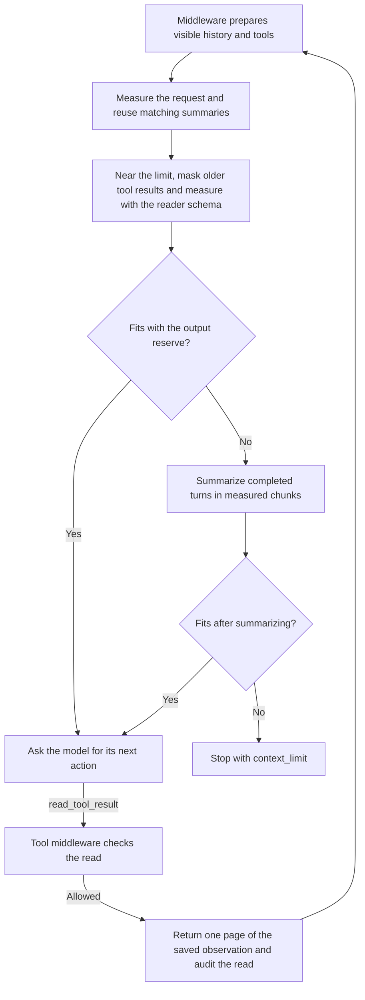

# Context limits and compaction

Every model call has an input budget, including the next call after a tool returns. The harness first lets middleware prepare the messages and visible tools. It then measures the complete candidate request. A request fits when its measured size plus the output reserve is at most the window.

## Tool results and older turns

Near 90% of the input allowance, the harness replaces older tool exchanges with compact markers containing the tool name, arguments and source call ID. An application can retain selected facts with `Tool(..., summarize=balance_facts)`. The model can retrieve a saved observation with `read_tool_result(call_id=..., offset="0")`. Page size scales with the configured window up to 8,192 characters of JSON, with a continuation offset. The harness can shorten a page further to fit the current request. The reader counts toward the turn's call limit. Middleware can hide the reader, deny a request, or remove the source exchange to revoke access.

If masking is insufficient, the harness summarizes completed turns in measured chunks. It keeps the current turn and privileged instructions, inserts the summary and measures the resulting request again. A matching visible prefix allows summary reuse. Override the default model summarizer with `Harness(..., summarize_history=fn)`. Audits record the summary input, outcome and whether it saved space.

For a compaction experiment, replay the same long task with different context budgets. Measure whether the agent preserves corrections, respects authorization and reaches the right final state, along with retrieval calls, latency and estimated cost. The number of compactions describes the run.

## Dispatch guarantees

The Terra adapter allows a 384 KiB local window, including 16 KiB of headroom. It measures the UTF-8 bytes of the serialized prompt and output schema before dispatch. Codex adds its own framing. Provider token usage returned after a call cannot guarantee that a future request will fit. The interactive demo and authored evaluator accept `--require-verified-context` and reject the Plus configuration if that guarantee is required. Adapters without a declared budget get a conservative 16 KiB fallback. [Codex adapter](../../adapters/codex_cli.py)

The separate GPT-5.4 mini Responses adapter counts the assembled provider input, including tool definitions, against its 400,000-token window. It reserves at least 16,384 tokens for output and caps each generation at the smaller of the remaining space and the model's 128,000-token output limit. An invalid or unavailable count stops generation. [Model specification](https://developers.openai.com/api/docs/models/gpt-5.4-mini) · [Adapter implementation](../../adapters/openai_responses.py)

A provider context rejection allows one retry at a smaller input ceiling. Completed tools retain their outcomes. If the protected input cannot fit, the harness ends the turn with `context_limit`. A measurement or summary failure yields `context_error`. Follow `context.checked`, `context.compacted`, `context.summary_requested` and `context.retry` in the turn audit. [Run context](../../harness/context.py)
