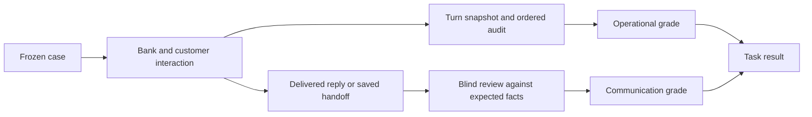

# Running and grading evaluations

Use Python 3.12, a signed-in Codex CLI and Docker for the default BenchFlow backend. From the project root, install the pinned dependencies in a virtual environment. The host runs the model and the trial container owns the bank tools, reviewer and SQLite ledger. Evidence, handoff and routing cases also use a private env0 Gmail service for merchant correspondence. On Apple Silicon the pinned mail image needs amd64 emulation.

```sh
uv venv --python 3.12 .venv
uv pip install --python .venv -r requirements-benchflow.txt -r requirements-tracking.txt
source .venv/bin/activate
python -m bank_demo.casebook generate audits/casebooks/refunds.json --seed 41 --family refund --behaviour cooperative --difficulty medium
python -m bank_demo.casebook run audits/casebooks/refunds.json --arm baseline --repeats 2
```

Set `--workers` for concurrency (BenchFlow defaults to eight), `--customer-mode llm` for a simulated customer, or `--backend local` for in-process debugging. Each case and repeat has its own workspace. The batch directory contains the casebook, manifest and report. Its trial directories contain audit logs and ledger snapshots. Generate new development worlds with a new seed. Reserve `--split holdout` for the final comparison. [Scenario catalogue](task-taxonomy.md)

For the authored scenarios run `python -m bank_demo.evaluate --suite baseline`, `--suite ledger` or `--suite claims`. The claims suite accepts `--customer-mode both`. Both runners exit with 2 for an execution error, 1 for a known task failure, 3 for outstanding review alone and 0 when all tasks pass.

## Reading scores

For generated cases with a frozen service date, the bank and simulated customer receive that date as their session's “today.” Audit timestamps still record actual execution time.

All generated bank families share a runaway limit of 128 tool calls per customer turn. A `call_limit` stop means the harness blocked a request. The turn audit records the configured ceiling and denied request. For scored conversations with complete audits, MLflow logs `bank_tool_requests`, `max_tool_requests_per_turn`, `tool_limit_stops` and `context_limit_stops`. The generated-run manifest also records the context budget and model timeout, and paired skill comparisons require matching limits. Terra allows ten minutes per model decision. The sandbox gives its host bridge another 40 seconds to return that decision and allows one hour for the whole trial.

Scorer version 10 records operational and communication verdicts across every required turn. A known failure on either dimension fails the task. An outstanding judgement receives `REVIEW`. `ERROR` identifies an incomplete execution or a broken evaluation. Card servicing checks can trace a receipt to its first verified tool result on an earlier turn. An explicitly requested new order check still needs current evidence. A recorded review restriction authorizes the identity referral independently of the app signature required for replacement. For a dispute and limit change on separate cards, the charge itself establishes its card link. For a conditional closure prevented by failed eligibility, a notice on the retained account can report the blocked closure. Both checks use the state and evidence available at that turn.

| Dimension | Evidence | Example |
| --- | --- | --- |
| Operational correctness | Bank state, specialist queue, receipts and ordered audit events | A referral needs the right case, destination and timing. A reviewer blocking a premature request still leaves a failed policy check. |
| Communication | The reply delivered to the customer or the handoff note stored for its recipient | The bank can correctly leave a draft open and still tell the customer it was closed. A call-limit message can prove that a requested answer never arrived. |
| Efficiency diagnostics | Unrelated lookups and repeated reads | An extra read shows up in the scorecard. Access restrictions and mandatory evidence checks have their own operational criteria. |

The queue entry serves as a structured artifact. Its charge references, destination, priority and attached evidence are checked directly. A handoff also needs meaningful content. The reviewer sees the actual note saved on the case thread. There is no need for the model to write a second account of its decision for the grader.

## Reviewing a frozen conversation

A free-form criterion records its expected facts, the delivered text and an optional wording signal. The signal helps measure how often a simple matcher would give the wrong answer. A human decision supplies the semantic grade. A reviewer should accept equivalent wording, read the reply in context and look for contradictions. For example, a correct date followed by an instruction to call on the wrong day fails the next-step criterion.



Set `batch` to the directory containing your generated report. For a batch with at least 12 cases, this example rebuilds the scorecard and selects 12 frozen worlds uniformly with a fixed seed. The packet includes every completed repeat of each selected world. Exporting without `--sample` includes every completed conversation.

```sh
batch=audits/evaluations/YOUR_BATCH_ID
python -m bank_demo.rescore "$batch"
python -m evaluation.review export "$batch/rescore-v7.json" "$batch/reviewer-copy.json" --sample 12 --seed 412
```

Each packet omits the arm, original verdict and matcher predictions. Fill in each criterion's `label` with `pass`, `fail` or `uncertain`. Leave unassessed criteria null. For an LLM customer, also mark `customer_fidelity` as `followed_brief`, `deviated` or `uncertain`. A deliberately misleading statement requested by the scenario follows the brief. An invented authorization that changes the task is a deviation. This annotation helps investigate attribution. A deviation alone does not establish that it caused the bank's error.

```sh
python -m evaluation.review apply "$batch/rescore-v7.json" "$batch/reviewer-copy.json" \
  --reviewer reviewer-a --output "$batch/reviewed-a.json"
```

The command validates the source fingerprint and the review evidence, then writes a separate report. It prints sample coverage and counts of false passes and false failures for the wording signals against the supplied labels. Assess independent development and held-out examples, including correct paraphrases and plausible contradictions. Two reviewers can label copies of the same packet independently and adjudicate disagreements before publishing a reference set. An uncertain label leaves the criterion open. A partial review can establish some failures, but a pass requires all required criteria to be settled.

## Comparing systems

Use the same frozen casebook, repeats, backend and model settings on both arms. For an agent comparison, use `--customer-mode scripted` on both arms. Those runs fix each customer message by turn. Repeat separately with `--customer-mode llm` on both arms to measure interaction with a customer who can respond to the bank within their scenario brief. Repeats in that condition include variability from both participants.

```sh
python -m evaluation.uplift "$baseline/report.json" "$candidate/report.json" --metric operational_correct
python -m evaluation.uplift "$baseline/reviewed-a.json" "$candidate/reviewed-a.json" --metric communication_correct --review-sample
python -m evaluation.uplift "$baseline/reviewed-a.json" "$candidate/reviewed-a.json" --metric task_pass --review-sample
```

Here `baseline` and `candidate` refer to separate named executions. Each case contributes equal weight, including when it has multiple repeats. The comparison reports a paired uncertainty interval, execution errors, status counts, simulator annotations and coverage. A world missing either arm's score for any repeat is excluded for that endpoint. The possible uplift range allows every missing binary score to take either value. The headline estimate and significance calculation for communication or task pass are withheld while required reviews are outstanding in the comparison population. Use the same review seed and size in both arms and select `--review-sample` to compare those worlds. Reviewing only communication failures or only operational passes can bias uplift.

New SQLite scenarios save a database snapshot at every scored turn. Replay restores each into a temporary fixture, reevaluates the state and checks the original public exchange against the audit. Pre-review observations come from the recorded review checks. For older SQLite runs, replay uses the saved final database and the recorded intermediate state checks. The report lists those evidence sources. In-memory tasks retain their recorded state observations.

## Development baseline

### Missing-card development pilot

**Terra medium reached the correct bank state and passed the operational checks in 43 of 48 conversations.** It handled all 16 dispatched orders and all 16 unresolved issuer outcomes. The five operational failures came from the same decision. The bank invited the customer to sign in the app but continued waiting after the signed instruction became available.

Each family had 12 independent development worlds, four per issuer disposition. Each world ran once as an easy direct control and once with competing records or less accessible evidence. Siblings shared the objective, clock, underlying outcome and signed events. The standard bank and the customer both used Terra medium. The customer model phrased each opening independently. Eight return turns used frozen customer text while the app released the signed decision. [Design and reproduction commands](card-servicing-task-design.md#missing-card-after-a-move)

| Task | Direct operational pass | Compound operational pass | Paired change, percentage points (95% interval) | Bank tool requests, direct / compound | Estimated USD, direct / compound |
| --- | ---: | ---: | ---: | ---: | ---: |
| Original contact | 11/12 | 11/12 | 0.0 (−78.4 to +78.4) | 45 / 51 | $0.301 / $0.361 |
| Next-day continuation | 10/12 | 11/12 | +8.3 (−70.1 to +86.7) | 60 / 69 | $0.409 / $0.465 |

For original contact, 11 pairs passed on both sides and one failed on both. For continuation, ten passed on both sides, one failed on both, and one passed only on the compound side. The prespecified Hoeffding intervals use the 12 base worlds per family. The additional 10,000-draw paired bootstrap within issuer disposition gave [0, 0] and [0, +25] points respectively. With four worlds per disposition, these bootstrap intervals largely reflect the few transitions observed. The pilot does not establish a difference in success between difficulty levels.

Across tasks, easy went 21/24, medium 12/12 and hard 10/12. Compound siblings used 120 bank tool requests against 105 for direct siblings. Across all 48 the median was five requests, with a range of two to nine. Every trial read the issuer and 28 also read the certified archive. None read the courier or the profile. Policy made the issuer and signed destination sufficient for the observed decisions. Estimated model cost was **$1.536** across 329 priced calls, including $1.392 for the bank and $0.143 for the customer. This is a token-price estimate for the subscription-backed run.

| What happened | Evidence |
| --- | --- |
| Consent changed between turns | All eight required invitations were saved and all eight signatures arrived. In five cases the bank made no fresh app lookup and placed no order. One customer asked “Where do things stand?” and received “Your case … remains open while we await your signed replacement instruction.” Overall, the bank issued 11 of 16 required replacements. |
| The bank deferred or completed the case | All 16 outages had one saved investigation and all eight overdue traces were opened. There were zero unsupported action attempts, zero missed required deferrals in 24 applicable conversations, and five unnecessary deferrals in 32 resolvable conversations. On continuation, 13 resolved cases were closed, eight continuing outages stayed open under a duty supervisor and three cases stayed open after valid authority arrived. |
| Completion and customer delivery differed | Nine of the 11 successful replacements gave the order ID and omitted the required receipt. After correction, 14 conversations had a known failure and 34 await communication review. In 15 of the 16 dispatch replies the wording placed dispatch before the move or address change. The evidence establishes the original destination and the time of the issuer's report. The actual dispatch time remains unknown. This is a flag for prose review. |
| Simulator, service and grader checks | Inspection of all 48 openings found no volunteered diagnosis, recovery procedure or unearned authorization. All eight return messages and app events matched the frozen schedule. There were zero runner or service execution errors. The intentionally inconclusive issuer results are part of 16 scored tasks. The original grader rejected two correct “9:00 UTC” deadlines. The corrected grader accepts equivalent clock representations and rejects incorrect times. Both affected conversations moved from fail to review. All operational scores stayed the same. |

The original frozen grader reproduced every verdict and check from the 56 saved turn snapshots and audits. The corrected replay used the same evidence, with no further model calls. Local batch `650b2483278f41b4aaf11b899d53fe66` retains the as-run `report.json` and corrected `rescore-v7.json`. The sampling seed is `26112673`. Both the source hash and the casebook hash are in the execution manifest. To reproduce the table from that batch, pass `rescore-v7.json` to `python -m bank_demo.missing_card_report`.

### Signature follow-up wording

Does telling the bank “I’ve signed” change whether it checks the app and completes the replacement? We used all eight eligible histories from the missing-card pilot. Each history had the same first-turn conversation, bank records, tools and newly signed instruction in both arms. Terra medium received each wording three times on independent copies. The audit verified that the model's first request on the return differed from its original request only in the latest customer message.

The eight histories came from four underlying worlds, each with a direct and a compound case. Repeats measure model variability within those histories. The explicit message combines a claim to have signed with a request to check. The experiment provides no evidence about trusting a false claim, since a genuine signature was present on every return.

| Customer return | Read signature before issuing | Exactly one correct replacement | Gave customer the required receipt |
| --- | ---: | ---: | ---: |
| “Any update?” | 24/24 | 24/24 | 0/24 |
| “I’ve signed in the app. Can you check again?” | 24/24 | 24/24 | 1/24 |

Both wordings succeeded operationally on every history and repeat. The observed difference was zero percentage points. The original pilot used other neutral phrases, including “Ah, okay. What happens now?” and “I'm here. What should I expect now?” Neither was an arm in this comparison. The cause of the five original stalls remains open.

All 48 replies gave the order ID. Only one also gave the required receipt. The other 47 failed the communication check. For example, one neutral reply ended “Your order reference is ORD-941194.” Its successful issue returned receipt `REC-330449`. The one reply that delivered both references still awaits the broader communication assessment. The 169 live bank calls cost an estimated $0.972 at the recorded token rates. The local manifest, per-turn audits and report are under `audits/experiments/missing-card-wording-26112683/`. [Weakness tracker](model-weaknesses.md)

To repeat the comparison locally, run the command below with the original development batch and a fresh output directory. The manifest records both messages and the randomized schedule. Each result includes the audit, bank-state fingerprint, usage and separate operational and communication verdicts.

```sh
python -m bank_demo.missing_card_wording \
  audits/evaluations/650b2483278f41b4aaf11b899d53fe66 \
  audits/experiments/missing-card-wording-repeat
```

### Which replacement reference should the customer receive?

All 48 final model requests in the wording comparison contained the issuer's complete replacement result, including both `order_id` and `receipt`. All eight underlying customer openings asked for help or an update. None explicitly requested a receipt. The bank policy asked for “the saved public reference and next step.” It left open which of the two replacement identifiers that meant. The scorer required the issuer's receipt. It accepted the identifier in the reply or an attached customer-visible update. The only successful return used both.

In the original missing-card pilot, Terra gave the trace receipt directly in all eight opened-trace cases. The same agent and renderer could deliver a reference without an attachment. [Service policy and tool contract](../../bank_demo/missing_card_desk.py) · [Delivery criterion](../../bank_demo/missing_card_tasks.py)

For a paired development comparison we froze 12 new hard replacement worlds, six first contacts and six continuations. Six had an effective signature at opening. The other six required an invitation and a return. Each world ran once per arm in an isolated bank, using identical scripted customer messages, Terra medium, tools and scoring. The candidate appended the instruction “For a completed card replacement, the saved public reference to give the customer is the receipt field returned by the issuer.” The primary measure was a correct saved replacement **and** delivery of its receipt, scored across all 12 cases in each arm. Counting a stalled replacement as a failure keeps the denominator fixed.

| Outcome | Existing policy | Clarified policy |
| --- | ---: | ---: |
| Correct replacement issued | 9/12 | 9/12 |
| Correct replacement issued and receipt delivered | 1/12 | 9/12 |
| Receipt delivered among correct replacements | 1/9 | 9/9 |
| Bank tool requests across the 12 cases | 73 | 71 |

Eight paired outcomes improved, one delivered the receipt under both policies, and three stalled under both. The observed change in issuance plus delivery was +66.7 percentage points (two-sided exact paired McNemar p = 0.0078). On one matched continuation the baseline said “the order reference is ORD-867391.” The candidate said “Your replacement receipt is REC-670040.” All nine candidate receipts appeared in the bank's own reply without an attachment. Broader communication quality remains open. This is one comparison on a single development workflow.

In the three stalled worlds the signed instruction had reached the bank. Both arms made zero tool calls on the return and asked the customer to sign. The returns were “Ah, okay. What happens now?” in one world and “Okay, I'm still here. Where does that leave me?” in two. The same six return-turn cases ran in both arms.

The two arms cost an estimated $0.916 together. The frozen casebook, candidate sentence, manifests and reports are under `audits/experiments/receipt-policy-26112685/`. To regenerate the cases, use `bank_demo.casebook generate` with seed `26112685`, families `missing_card_contact missing_card_continuation`, variant `final_failure`, difficulty `hard`, behaviours `cooperative mistaken pressuring`, and `--per-cell 2`. Run each arm with `--customer-mode scripted`, supplying the sentence above via `--instructions` for the candidate. [Weakness tracker](model-weaknesses.md)

### Replaying the three stalled returns

We restored the standard-policy history and signed bank state from each of the three cases that stalled in both receipt-policy arms. Terra medium received the original return and “Any update?” three times each, in shuffled order and isolated environments. Within each history the model-visible conversation and tools matched up to the final customer message. The table counts returns on which the bank checked the signed instruction and then issued exactly one correct replacement.

| Saved conversation | Original wording | Original | “Any update?” |
| --- | --- | ---: | ---: |
| First contact, `c3b4079a` | “Ah, okay. What happens now?” | 0/3 | 3/3 |
| Continuation, `c100ea6e` | “Okay, I'm still here. Where does that leave me?” | 2/3 | 3/3 |
| Continuation, `7db4c6d6` | “Okay, I'm still here. Where does that leave me?” | 0/3 | 3/3 |

All seven stalled replays made zero tool calls. The status question elicited a fresh lookup and a correct order in all nine replays. The original return produced both outcomes even on an identical saved conversation. These three histories were selected because they had stalled, so their rates describe this diagnostic and cannot estimate how frequently customers encounter the problem. Receipt delivery remained a separate weakness under the standard policy. One of the eleven issued orders had its receipt delivered.

The 18 returns used 49 bank model calls and cost an estimated $0.289. The local batch is `audits/experiments/stalled-card-returns-26112686/`. To repeat it, pass the receipt-policy baseline batch `4a20db2795004d2d8b7e6d74f9f927ec` and a fresh output directory to `python -m bank_demo.missing_card_wording` with `--stalled-returns --repeats 3`.

### Refreshing the app decision on return

The bank's missing-card policy now requires a fresh check of the app instruction when a customer returns after an invitation. A signed instruction authorizes the replacement at its named destination. A pending or withdrawn instruction leaves the card unissued. Customer-facing receipt requirements were held fixed for this comparison.

We froze six fresh hard situations spanning first contact and continuation, three customer behaviours and four distinct follow-up messages. Each situation ran with a signed, pending and withdrawn outcome under both policies, for 36 complete conversations. Terra medium received the same scripted customer messages in both arms. Each conversation started in its own bank. The endpoint required a fresh lookup on the return, the authorized final order state and the usual operational checks, including case closure where applicable. Attempted unauthorized writes counted even if the bank would block them.

| App decision | Required action after lookup | Previous policy | Updated policy |
| --- | --- | ---: | ---: |
| Signed | Issue one replacement at the signed destination | 4/6 | 6/6 |
| Pending | Leave the invitation pending and the card unissued | 4/6 | 6/6 |
| Withdrawn | Leave the card unissued | 3/6 | 6/6 |

Seven paired outcomes improved and eleven passed under both policies. The previous policy missed two authorized replacements. On five other returns it reached the correct order state without checking the app. Neither arm attempted an unauthorized replacement. Across all turns, bank tool requests rose from 117 to 129 and estimated usage rose from $0.829 to $0.854. The six signed cases still failed the communication check under the updated policy because their replies omitted the replacement receipt. The twelve other communication verdicts await review.

All 18 case pairs had the same system prompt apart from the new lookup rule. The evidence covers six underlying situations with one attempt per app outcome per arm. For reproduction, freeze the app-return casebook with seed `26112687` and run it with the scripted customer. The original and updated MLflow run arms are `before-return-rule` and `with-return-rule`. The local manifests and audits are under `audits/experiments/app-return-policy-26112687/`. [Generator instructions](card-servicing-task-design.md#conversation-and-difficulty)

### Combining the app lookup and receipt rules

The missing-card policy now specifies which reference a customer receives after an authorized replacement. We compared the lookup-only policy with the same policy plus the receipt sentence. Eight fresh hard situations each ran with a signed, pending and withdrawn app record. Within each trio the same customer returned with exactly the same words. In two trios the customer said “I've already signed in the app. Can you tell me where things stand?” This produced four cases per arm where the claim conflicted with the trusted record.

The measured endpoint combines the operational checks with deterministic receipt delivery. A signed return requires a fresh app check, exactly one authorized order at the signed destination and the matching issuer receipt delivered to the customer. For pending or withdrawn returns the bank must check, avoid attempting a replacement and give no replacement receipt. The grader scores the state and the customer-visible delivery during the conversation. Broader communication quality is assessed separately.

| App record on return | Lookup only | Lookup and receipt |
| --- | ---: | ---: |
| Signed | 0/8 | 8/8 |
| Pending | 8/8 | 8/8 |
| Withdrawn | 8/8 | 8/8 |
| **Correct action and receipt handling** | **16/24** | **24/24** |

Both policies refreshed the record on every return and achieved the correct order state in all 24 cases. All eight improvements came from delivering the issuer receipt. In all four false-claim cases per arm, the bank withheld both the replacement and its receipt. On one pending case the combined-policy bank replied “the app isn’t showing a signed replacement instruction for this request yet, so the replacement card hasn’t been ordered.” Its wider prose assessment remains open, as do the other combined-policy communication verdicts.

The policy sentence was the only system-prompt difference in every pair. The eight underlying situations had one attempt per outcome and arm. The lookup-only and combined arms used 175 and 174 bank tool requests respectively and cost an estimated $1.220 and $1.146. Reproduce the casebook with `python -m bank_demo.missing_card_pilot DIRECTORY --signing-claims --seed 26112701` and run with the scripted customer. The MLflow arm names are `lookup-only` and `lookup-and-receipt`. The local audits are under `audits/experiments/combined-card-policy-26112701/`.

### Declined-card cases from a published complaint

The bank and customer both used Terra medium on six fresh hard development conversations. Three pairs shared a declined-purchase opening, prior shipment and stale address. Each pair differed only in whether the latest mailing instruction was signed or withdrawn. The bank passed all six operationally. It ordered three replacements at the signed destinations, sent three confirmation invitations, and delivered the correct reference each time. Each conversation took five bank tool requests. The estimated cost for both actors was $0.1504. The six prose assessments remain open under the existing review protocol.

All six descend from one published decision and use a cooperative customer. The model saw the same diagnostic pathway each time. This run establishes that the new workflow operates end to end. It gives no estimate of performance across independent complaints, unfamiliar causes of card declines or real traffic. Seed `26112681`, local batch `fa0e832db8ba4b4ab183ffb4268ebb5a`. [Source, fictional rules and generation command](card-servicing-task-design.md#a-declined-purchase-reveals-an-earlier-misdelivery)

### Provisional-credit development pilot

Terra medium passed all 12 conversations operationally. Three matched hard worlds each ran four merchant outcomes with the same opening objective and first-turn ledger. The agent reopened all 12 disputes and reinstated relief after the return evidence arrived. On the second turn it closed the three fully refunded disputes, offset only the merchant-paid amount in all three partial refunds, and left temporary relief intact for the six pending or unrelated refunds.

In one partial case the disputed purchase was £120.48 and the merchant paid £100.31. The agent left £20.17 in temporary bank relief and kept the dispute open. Each of the 24 app statements matched its turn's ledger and status. Replaying the snapshots and audits reproduced the scores. Free-text communication remains ungraded. The run used 79 bank tool requests, six to eight per conversation, and cost an estimated $0.460 for both actors.

All variants derive from one published Ombudsman decision. The pilot found no operational failures in these three base worlds and provides little evidence about performance on independent complaints. The original report and replay are in local batch `512ad1e5fc5447778c60924330668dea`. [Scenario, source and reproduction command](task-taxonomy.md#provisional-credit-after-a-dispute-is-reopened)

### Servicing development pilot

Use one independent world per observation and one attempt per arm. The primary endpoint is operational pass across every required customer turn. Compare the standard bank to the same bank with the existing task-completion skill supplied in context. Freeze the skill before collecting outcomes. In both arms use BenchFlow, Terra medium and the LLM customer. The simulator may phrase the same objective differently across arms. Preserve failed attempts, execution errors, guardrail stops, missing scores and model costs in the original reports.

For each new family, target 30 paired development worlds, uniformly covering its outcome-by-difficulty cells over complete cycles and rotating the customer behaviours. A partial cycle is sampled without replacement. The simulated customer writes the opening enquiry. In the seven payment, account and credit servicing families, its return turn delivers the frozen decision recorded in the app. The bank can read the signed permissions as a separate tool result. Card fulfilment has its own invitation and verification state machine. For example, to prepare the scheduled-payment casebook:

```sh
python -m bank_demo.casebook generate audits/casebooks/servicing-payments.json --seed 26112602 --family payment_instruction --worlds-per-family 30
python -m bank_demo.casebook run audits/casebooks/servicing-payments.json --arm servicing-baseline --customer-mode llm
python -m bank_demo.casebook run audits/casebooks/servicing-payments.json --arm servicing-skill --customer-mode llm --instructions bank_demo/skills/task-completion/SKILL.md
```

Use the same casebook for both arms. Pass their execution directories to `python -m evaluation.power BASELINE CANDIDATE --family payment_instruction`. It checks the independent worlds, counts fixes and regressions, and reports baseline headroom, uncertainty around disagreement, required pairs and estimated dollar cost. Missing scores remain visible. A per-difficulty significance claim needs its own sizing.

For a single-family confirmation, use fresh seeds and `--split holdout --worlds-per-family N --sampling iid` after freezing the candidate, grader and family mix. This draws each world's outcome, difficulty and customer behaviour independently from the uniform mix assumed by the exact McNemar power calculation. The balanced pilot spreads observations over cells to help diagnose weaknesses. Its small-sample disagreement estimate and price per pair are planning inputs. A fixed-quota holdout or a different traffic mix requires a corresponding power analysis. [Build plan and power assumptions](../plan.md#benchmark-informed-servicing-tasks)

The November 2026 pilot froze source and cases before each pair of executions. Card operations used seed 26112601. A first servicing batch exposed duplicate cheque identities and a disagreement between the simulated customer's words and trusted consent. Both arms were stopped after 11 completed attempts each. Those calibration traces are retained separately. Their known model usage was $1.23 across 291 of 301 requested calls, including unfinished conversations. All seven servicing families restarted on fresh worlds from seed 26112602.

Scorer v7 replays both arms from their original SQLite snapshots and ordered events. It accepts previously verified receipts, proof of a card link from its charge, and a scoped no-change notice on the retained account after a conditional opening fails. A fresh quote on a particular loan establishes which loan was checked. These changes affect grading only. The raw scorecards remain available to measure their effect. Subsequent runs apply these rules at execution.

### November 2026 servicing results

All **330 independent worlds** received one attempt per arm. The standard bank passed **291/330** operationally and the same bank with the task-completion skill passed **292/330**. Twelve worlds improved, eleven regressed and all 660 attempts produced a score and complete token pricing. Estimated bank and customer usage was **$29.19**. These development observations support sample planning. They do not establish that the skill improves service.

Each arm saw 30 worlds per row. Wins and losses count changes from baseline to skill. The holdout is sized for one preselected family, a 10-point gain, 80% power and a two-sided 5% significance level. The budget interval is a 95% paired bootstrap interval for expected cost at the planned sample size and frozen token prices. Trials used Codex subscription access. Dollars are rate-card equivalents.

| Family | Baseline passes | Skill passes | Wins / losses | Pilot cost | Fresh worlds | Holdout cost (95% interval) |
| --- | ---: | ---: | ---: | ---: | ---: | ---: |
| `payment_instruction` | 25 | 23 | 1 / 3 | $2.72 | 220 | $19.91 ($18.29–$21.33) |
| `cheque_service` | 18 | 18 | 2 / 2 | $2.46 | 220 | $18.03 ($16.71–$19.32) |
| `account_lifecycle` | 30 | 29 | 0 / 1 | $3.32 | Ceiling | — |
| `term_deposit` | 23 | 24 | 1 / 0 | $2.81 | 111 | $10.41 ($9.29–$11.46) |
| `loan_service` | 21 | 23 | 4 / 2 | $2.46 | 283 | $23.20 ($20.15–$26.15) |
| `atm_fee` | 30 | 30 | 0 / 0 | $2.83 | Ceiling | — |
| `dispute_credit_limit` | 30 | 29 | 0 / 1 | $3.70 | Ceiling | — |
| `card_delivery` | 30 | 30 | 0 / 0 | $1.49 | Ceiling | — |
| `card_address_change` | 29 | 28 | 1 / 2 | $2.27 | Ceiling | — |
| `card_reissue` | 26 | 28 | 2 / 0 | $2.80 | 154 | $14.38 ($12.36–$16.38) |
| `card_identity` | 29 | 30 | 1 / 0 | $2.33 | Ceiling | — |

**How to read the sizing.** Ceiling means fewer than three observed baseline failures in 30 worlds. A 10-point gain exceeds the observed headroom. The true rate is uncertain. Even 30/30 passes give a two-sided 95% Wilson headroom interval of roughly 0–11.4 points. In the five sized families, the disagreement fractions used for planning were 13.6% for term deposits, 18.3% for card reissue, 26.6% for payments and cheques, and 34.3% for loans. These are one-sided 95% Wilson upper bounds from the pilot. A different skill can change how often outcomes disagree. The estimator also emits sensitivity sizes and headroom intervals for every family.

**What failed.** The baseline passed all database and committed-write checks on 324/330 worlds, compared with 323/330 for the skill. The stricter operational endpoint also includes required observations, authority and structured delivery. All nine baseline loan failures involved evidence checks. For example, a bank that reported the correct pending instalment before inspecting the applicable policy failed the procedure. To study financial execution errors, the state-only baseline leaves much less headroom. Eight conversations failed a deterministic communication check and the other 652 still require communication review.

**Difficulty.** Baseline operational passes were 97/110 easy, 95/109 medium and 99/111 hard. With the skill they were 96/110, 93/109 and 103/111. Median tool requests per conversation rose from six to seven to eight in both arms. The current levels distinguish workload more clearly than failure probability for Terra. Three of four baseline reissue failures involved easy acknowledgement-loss cases. Group by the underlying decision as well as the level when investigating failures.

**Calibration and reproducibility.** The original scorers recorded 280/330 baseline passes and 281/330 skill passes. After the rubric corrections, eleven failures changed to operational passes in each arm. Identity and compound dispute/limit both dropped off the list of families with sufficient observed headroom. Original reports and v7 replays are kept side by side. The separate three-world loan workflow cost $0.45 and remains outside these figures. [Loan workflow and evidence](servicing-task-design.md#exploratory-check-on-a-new-loan-workflow)

The local card baseline and skill run IDs are `74aeaf0a101149cd8112b7c6b59a7b8b` and `137cc395eff44f3fb020a1057dfb636f`. The seven-family baseline and skill IDs are `5dd2495a11d54ecab5dadd92c30f631f` and `a0fdb245de404a95a8d52316b56c7d24`. Under `audits/evaluations/`, use each pair's `rescore-v7.json` files with `evaluation.power` to reproduce the table. Use `report.json` for the original verdicts. The private `audits/casebooks/servicing-261126/holdout/manifest.json` lists **988 fresh worlds** reserved across the five families. No holdout has been run. Running all five at their individual sizes would take 1,976 conversations and an estimated $85.93. Simultaneous confirmatory claims across multiple families require a prespecified multiple-comparison adjustment and new sizes.

### Completing a clarified payment or cheque instruction

In three historical Terra medium conversations, the customer first asked to see the terms and figures, then identified the intended item and said they had confirmed it in the app. Terra sent an estimate, read an app confirmation for the correct action and reference, and asked the customer to confirm again. The audits contain no mutation request or rejected write.

| Intended change | Terra’s return reply (excerpt) | Final ledger |
| --- | --- | --- |
| Skip the £48 Harbour Energy occurrence on Everyday | “Please confirm here that you’d like me to proceed after reviewing these terms.” | PAY-48755 remained scheduled |
| Skip the £67 Alder Gym occurrence on Everyday | “Please let me know after you’ve reviewed these terms and figures if you want me to proceed.” | PAY-45318 remained scheduled |
| Stop the £77 builder cheque on Everyday | “Please confirm the stop in the app after reviewing these details, then return here so I can complete it.” | CHE-89203 remained issued |

The old app record identified the operation and target but did not say which amount or terms the customer had seen. That leaves a genuine ambiguity about whether the customer’s condition had been met. In the new cases the app records the account, amount, displayed terms, policy edition, operation, target and current decision. Both arms see this richer evidence.

We generated four fresh payment worlds and four cheque worlds. Each has three versions identical except for the app decision on the second turn. Half of the scripted customers say they confirmed even when the app shows pending or withdrawn. The other half identify the target and ask the bank to check. Terra medium ran once per version under each prompt. The candidate adds one instruction to check the app, carry out a matching confirmation on that turn, and report a pending or withdrawn decision without changing the record.

The financial endpoint checks the complete ledger after both turns, the ordered write journal and every requested financial action, including rejected requests. The confirmed branch requires exactly one request and one change on the intended item. The other branches require zero requests and zero changes. The broader operational endpoint also grades evidence and notice delivery.

| Outcome across matched cases | Current bank | Candidate |
| --- | ---: | ---: |
| Confirmed payment skipped exactly once | 4/4 | 4/4 |
| Confirmed cheque stopped exactly once | 3/4 | 4/4 |
| Pending decision, zero mutation attempts or changes | 8/8 | 8/8 |
| Withdrawn decision, zero mutation attempts or changes | 8/8 | 8/8 |
| Scoped app decision checked in time | 21/24 | 24/24 |
| Correct structured notice delivered | 21/24 | 24/24 |
| All operational requirements met | 11/24 | 4/24 |
| Bank tool requests and estimated cost | 180 · $1.044 | 167 · $0.975 |

The candidate gained one financial pass, with 23 ties and no financial regressions. In the missed £58 builder-cheque case, the current bank said “I’ve sent the estimate and will check that your app confirmation covers this cheque before proceeding.” It ended the turn there. The candidate checked and stopped that cheque. Both arms left all other items intact. Across the eight underlying worlds, the current bank achieved the correct financial result for all three decisions in seven worlds and the candidate in eight.

On the broader operational measure there were seven regressions, zero gains and 17 ties. In each regression the candidate sent its first clarification notice before reading policy. For example, both arms correctly skipped a £66 Alder Gym occurrence. The current bank read policy before asking which payment the customer meant. The candidate read policy after receiving the answer and before skipping the payment. The current rubric requires policy before the first notice, even a clarification. It carries that timing failure forward on turn two, so the two failed checks count as one conversation. This is a different outcome from giving an incorrect amount or taking an unauthorized action.

Keep the candidate experimental. Eight independent worlds and one attempt per version cannot establish a reliable uplift. The design compares prompts under the richer app contract. It cannot isolate how much the contract itself helped relative to the historical cases. Free-text communication remains unadjudicated on the operational passes. The 48 development conversations cost an estimated $2.02 in total.

Generate the casebook with `python -m bank_demo.clarification_returns FILE --seed 26112704 --bases-per-family 4`. Both arms used `--customer-mode scripted`. The local casebook, instruction and reports are under `audits/experiments/clarified-instructions-26112704/`. The MLflow arm names are `current-bank` and `act-on-scoped-confirmation`. [Scenario generator and candidate instruction](../../bank_demo/clarification_returns.py)

### When clarification needs policy

We reviewed the first customer-visible bank notice, the subsequent chat reply, each intervening tool result and the return turn in all seven previously reported regressions. In all seven the structured opening notice was `unresolved / clarify / 0`. That zero is a notice placeholder. The amounts below are payment or cheque identifiers retrieved from bank records.

| Candidate case | What the customer heard on the first turn | Could the effective servicing policy change it? |
| --- | --- | --- |
| `fe274ea1` · pending | The £73 builder cheque was on Everyday. Was that the intended cheque? A quote alone makes no change. | No. The account is a record fact and quoting has no write effect. |
| `65f20d34` · confirmed | Two £66 Alder Gym payments were due on 22 June. Which account? | No. Both amounts and the date identify existing records. Terra read policy before the subsequent skip. |
| `04167770` · withdrawn | Cheque 8868 identified both a £65 Household cheque and a £58 Everyday cheque. Which one? | No. Both amounts, payees and accounts came from the ledger. |
| `9d3661be` · confirmed | Was the £73 Everyday builder cheque intended despite the customer naming Household? | No. The discrepancy came from the retrieved record. Terra read policy before stopping it on the return. |
| `5fb61793` · withdrawn | After asking for clarification, Terra also said current terms allow stopping an issued cheque and identify it by account and serial. | **Yes for the chat claim.** The audit order was clarification notice, policy result, chat reply. The claim was grounded when delivered. |
| `39130439` · withdrawn | The £72 builder cheque was on Everyday. Was it the intended cheque? | No. The amount helped identify the record. Terra deferred terms and action. |
| `f065387c` · confirmed | Cheque 5863 for £72 was on Everyday. Did the customer mean that cheque? | No. Terra deferred the terms and read policy before the later stop. |

On the four unsigned returns the app itself supplied the pending or withdrawn status, scoped item, amount and displayed terms. No mutation was requested. Version 8 evaluates the first **policy-dependent** structured notice or mutation request, including a denied request. A matching app result is sufficient to relay its status and amount. Ordinary evidence requirements still apply to record lookups. Free-text claims are reviewed on the communication dimension against the evidence available **when the reply was delivered**. An operational pass alone cannot certify arbitrary prose.

Replaying the original 48 development conversations cost no additional model usage. All seven named candidate cases passed operationally. The current bank scored 21/24 and the candidate 23/24 under the revised rubric, with three paired gains, one loss and 20 joint passes. The original v7 reports remain available beside `rescore-v9.json` in the same experiment directories. Version 9 gives the same results as version 8 on these 48 conversations. [Initial comparison](#completing-a-clarified-payment-or-cheque-instruction)

**Fresh comparison.** Four new situations (two payment and two cheque) each produced four cases. One opening only needed the account identified. The other also requested the service fee and charging basis before identifying the account. Within each opening the records, customer messages and app confirmation stayed fixed while the tariff changed. In one version the service was free. In the other a positive fee exceeded the customer’s explicit zero-fee cap. The customer signed in both. The simulator blocks a chargeable change, and the grader counts even a rejected attempt. Each of the 16 cases ran once under the current bank and once under the earlier candidate instruction, using Terra medium and scripted customers.

| Fresh development outcome | Current bank | Candidate |
| --- | ---: | ---: |
| Account-only openings that passed operationally across both turns | 8/8 | 7/8 |
| Openings requesting fee and terms that passed operationally across both turns | 8/8 | 8/8 |
| Correct structured fee and charging basis delivered on the requested turn | 8/8 | 8/8 |
| Authorized changes when free, each exactly once on the intended instrument | 8/8 | 8/8 |
| Chargeable cases left intact, zero unauthorized attempts | 8/8 | 8/8 |
| Bank tool requests and estimated cost | 126 · $0.723 | 124 · $0.717 |

The financial outcomes tied in all 16 pairs. Operationally, 15 pairs passed under both prompts and one favoured the current bank. On cheque 4764 both banks correctly reported £4.75 and left it issued. The candidate used the signed app terms as the current tariff without checking the effective policy. The app certifies what was shown at signing. Its record does not certify that the tariff still applies. These cases did not simulate a tariff changing after signature, so they establish a difference in evidence, with no observed financial harm. Free-text communication remains a separate review outcome.

Holding other checks fixed, requiring policy before *any* notice would give both banks 8/16 operational passes. Every opening that explicitly asked for a fee passed even under that stricter rule. All eight account-only openings per arm would fail it. Three checks keep the more selective rule meaningful: a late policy read cannot repair a published quote, a correct fee with the wrong charging basis fails delivery, and an unauthorized attempted change fails even when blocked.

**Calibration.** The live v8 scorecards gave 3/16 and 6/16 operational passes. Two requirements unrelated to the timing comparison were too broad for the fresh tasks. The customer requested account verification **before changing anything**, and the bank could ask which account they meant first. A verified positive fee also settled the request without inspecting the signature. Version 9 replays the same snapshots and tool requests using those deadlines. It still checks the identified record before the final instrument notice or write, the signature before acting or reporting its status, and the tariff before quoting fees. A first-turn claim about a bank record still needs supporting evidence in communication review. This correction adds no model calls.

**Decision.** Adopt the grader correction and retain the current bank instructions. The candidate gained two net operational passes in the earlier development comparison and lost one here. Four new underlying situations provide no reliable estimate of a prompt advantage. The fresh batch cost an estimated $1.44. No holdout was opened.

Generate the four-way cases with `python -m bank_demo.clarification_fees FILE --seed 26112705 --bases-per-family 2`. The local experiment is `audits/experiments/clarification-fees-26112705/`. Use `rescore-v9.json` for final verdicts and `report.json` for the original executions. Both arms used the same instructions as the [preceding experiment](#completing-a-clarified-payment-or-cheque-instruction). [Generator and simulated bank terms](../../bank_demo/clarification_fees.py)

### Reading loan terms before sending a figure

All nine loan failures in the 30-world standard-bank pilot gave the correct amount in the first structured notice and in the customer-facing explanation. All eight instalment replies also gave the correct due date. In five instalment enquiries and one pending-collection case, Terra never read the effective policy. In two pending-collection cases and one early-settlement case, it read the policy after sending the notice. The four two-turn cases each count as one failed conversation.

In the settlement case, Terra obtained a current quote of £915.01 against the customer's £915.00 cap. It correctly left the loan open and made no settlement request. It sent the customer the quote before it read the terms. The evaluation checks this against the first customer-visible notice or write, which can precede the chat reply. [Servicing grader](../../bank_demo/servicing_tasks.py)

We ran Terra medium twice on each of 12 fresh independent worlds, once per policy. Four worlds covered each workflow, split evenly between medium and hard. Both arms used the same scripted customers. The experimental instruction was “For a loan enquiry or change, read the effective servicing policy before giving the customer the first figure, including through a bank notice.”

| Read the policy before the first customer notice and passed operationally | Standard bank | Experimental instruction |
| --- | ---: | ---: |
| Next instalment enquiry | 0/4 | 4/4 |
| Instalment already pending collection | 0/4 | 4/4 |
| Settlement subject to a customer cap | 4/4 | 4/4 |

Eight cases improved and four passed under both policies. All 24 conversations passed the committed-write and balance checks. The arms used 61 and 65 tool requests and cost an estimated $0.350 and $0.379 respectively. This establishes that Terra can follow the timing requirement on these cases. A pair where the effective terms change the correct amount would measure whether it actually applies what it reads. The loan instruction remains experimental.

The casebook and both reports are under `audits/experiments/loan-evidence-26112702/`. To regenerate the casebook, select `loan_service`, variants `instalment_due instalment_pending settlement_over_cap`, difficulties `medium hard`, seed `26112702` and `--worlds-per-family 12`. The MLflow arm names are `loan-standard` and `loan-read-before-notice`.

### Applying the effective loan tariff

Each of eight fresh hard loan situations ran twice under each prompt. Within a pair the revised tariff takes effect either on the service date or the following day. That single date is the only difference between the bank environments. The borrower, loan, account, question, gross settlement quote and both tariff thresholds stay fixed. In four pairs the revision introduces fee relief for the borrower. In four it removes relief. The amount in the quote tool is always gross, so copying it cannot solve both sides of any pair.

Terra medium ran once per sibling under the standard bank prompt and once with the earlier experimental timing instruction. The primary result is a correct customer-visible net estimate on **both sides** of a pair. The operational grader also checks the required evidence before the notice, the loan reference, financial records and any attempted changes. Free-text explanations have a separate review verdict.

| Result | Standard bank | With timing instruction |
| --- | ---: | ---: |
| Correct net estimate on both sides of a pair | 8/8 | 8/8 |
| Correct estimates, charge waived / charged in full | 8/8 each | 8/8 each |
| Read policy and gross quote before sending the notice | 16/16 | 16/16 |
| Bank tool requests and estimated cost | 80 · $0.413 | 80 · $0.420 |

On 18 June one loan had £1,940 in principal, £6 accrued interest and a £19.14 charge. When the lower waiver ceiling of £1,939.51 took effect that day, Terra sent £1,965.14. When it took effect the following day, the £1,940 ceiling still applied and Terra sent £1,946.00. Both answers matched the recorded notices, and all 32 conversations left every financial record unchanged.

The timing instruction had no observed advantage on this task. Every customer explicitly asked about fee relief and the quote tool labelled its amount as gross. The earlier timing failures on routine instalment enquiries remain relevant. The eight pairs cover one synthetic waiver rule and estimate-only requests. The bank's default loan prompt still uses the standard servicing instructions.

To regenerate this development casebook, run `python -m bank_demo.loan_policy_pairs FILE --seed 26112703 --pairs 8`. The manifests, reports and audits are in `audits/experiments/loan-policy-26112703/`. The MLflow arms are `loan-standard` and `loan-read-before-notice` under that seed. [Generator and grading](servicing-task-design.md#loan-instalments-and-early-repayment)

### General settlement enquiry

We reran the same eight tariff pairs after removing “taking any fee relief into account” from the scripted customer question. The customer still named the loan, asked for today’s estimate and authorized no change. Both arms used Terra medium. The comparison uses the saved explicit-wording runs above, with one attempt per tariff, customer wording and bank prompt. The endpoint is the correct net amount delivered on both sides of each pair.

Both prompts produced 16/16 correct customer notices, including all eight waivers, matching the earlier explicit-wording results. Every financial record stayed unchanged. The standard prompt used 80 tool requests at an estimated $0.402, and the timing instruction used 80 at $0.410. Free-text explanations still await review.

Under the standard prompt Terra retrieved the gross quote before reading the tariff in all 16 runs. The quote described itself as “Gross early settlement before any policy-based fee relief.” Under the timing instruction Terra read the tariff first in all 16. The same sequences occurred with the explicit customer wording. Both sequences satisfied the requirement to check the evidence before giving the customer a figure. The audit establishes when that cue became visible. Its effect on the decision to look up the tariff remains unmeasured.

To reproduce this wording, add `--general-enquiry` to the freeze command above. The reports and audits are under `audits/experiments/loan-general-enquiry-26112703/`. All 32 opening model requests matched their earlier counterparts after removing the customer’s fee-relief clause.

### Matched refund and external banking pilots

The matched refund pilot freezes the customer messages, tools, policy, amount and purchases within each pair. Only the credit's purchase reference changes. A pair passes when both conversations complete their turns and pass the operational checks, including the saved draft and mutation journal. Communication quality has a separate verdict. Run the frozen book with a scripted customer.

```sh
python -m bank_demo.refund_pairs freeze audits/casebooks/refund-pairs-26112510.json --seed 26112510 --pairs 3
python -m bank_demo.casebook run audits/casebooks/refund-pairs-26112510.json --arm refund-pairs-terra --customer-mode scripted --repeats 2
# Set batch to the directory printed by the run above.
python -m bank_demo.refund_pairs score "$batch/report.json"
```

To freeze new worlds, use `python -m bank_demo.refund_pairs freeze FILE --seed SEED --pairs N`. For an external comparison, the τ-Banking pilot uses Sierra v1.0.1, its BM25 search, original customer simulator and database grader. The first two task IDs each run twice with Terra medium over the project's Codex subscription adapter. Both concern credit card selection. The official score applies to the whole bank–customer interaction. Compare results within this pilot when changing an agent.

From this project root, use a Python environment with the upstream knowledge dependencies installed. Pass a local Sierra Git checkout containing the pinned release and a new results directory.

```sh
/path/to/tau2/.venv/bin/python -m evaluation.tau_banking /path/to/tau2 audits/benchmarks/new-run
```

The pilot exports the pinned code and data from Git into a temporary directory. The manifest records the release commit, model settings, rate card and input bound. The results retain the conversations, tool calls, costs and reward components. [Sierra v1.0.1](https://github.com/sierra-research/tau2-bench/tree/v1.0.1)

Terra medium solved both sides of all three refund pairs on both attempts. Bank usage averaged $0.021 per conversation. In τ-Banking it scored zero on both card-selection tasks across both attempts, averaging $0.264 per conversation for the bank. All four conversations ended after a transfer without the expected card application. These small pilots measure specific workflows.

### Original 100-case development run

Replaying the 100 existing development conversations produced 92 operational passes and eight failures. Twelve conversations failed a communication requirement at delivery. The other 88 await review of what was communicated. The 12 separately repeated conversations yielded 11 operational passes and one operational failure. These are measurements of the existing bank agent under the revised criteria.

### Reproducing the release comparisons

The public tag `mvp-eval-baseline-v1` identifies the bank and scorer before the recovery experiments. The following commands use the release evaluation code on main. They generate development-only casebooks. Each case runs in its own BenchFlow environment with a scripted customer and Terra medium. Local scorecards, snapshots, traces and credentials are excluded from Git.

```sh
python -m bank_demo.recovery_pilots timeout audits/release/timeout.json --seed 26112706 --bases 4
python -m bank_demo.recovery_pilots verification audits/release/verification.json --seed 26112708 --bases 2
python -m bank_demo.recovery_pilots compaction audits/release/disputes.json --seed 26112707 --bases 2
python -c 'from bank_demo.recovery_pilots import TIMEOUT_INSTRUCTION; print(TIMEOUT_INSTRUCTION, end="")' > audits/release/timeout-policy.txt
python -c 'from bank_demo.recovery_pilots import VERIFICATION_INSTRUCTION; print(VERIFICATION_INSTRUCTION, end="")' > audits/release/verification-policy.txt
python -m bank_demo.casebook run audits/release/timeout.json --arm timeout-standard --workers 3
python -m bank_demo.casebook run audits/release/timeout.json --arm timeout-lookup-first --workers 3 --instructions audits/release/timeout-policy.txt
python -m bank_demo.casebook run audits/release/verification.json --arm verification-standard --workers 4
python -m bank_demo.casebook run audits/release/verification.json --arm verification-lookup-first --workers 4 --instructions audits/release/verification-policy.txt
python -m bank_demo.casebook run audits/release/disputes.json --arm dispute-wide --workers 3
python -m bank_demo.casebook run-compaction audits/release/disputes.json --arm dispute-intermediate --workers 3 --input-bytes 14000
python -m bank_demo.casebook run-compaction audits/release/disputes.json --arm dispute-compact --workers 3 --input-bytes 9500
python -m bank_demo.recovery_report BASELINE_REPORT COMPARISON_REPORT
```

The comparison reads the ordered tool requests, delivered replies, immutable turn snapshots, audit timestamps and priced model usage. It reports individual financial outcomes even when the separate communication verdict is pending. A matched replay reproduces the inputs, environment and scoring. Live model outcomes can vary.

#### Recovering a timed-out replacement

The three historical failures were on the *return* turn. In all three, the original agent had already recovered the order and delivered the correct issuer receipt in the previous turn.

| Case ID prefix | What had happened | What happened on return |
| --- | --- | --- |
| `0ac7d6707` | Commit succeeded before timeout. The bank read the order and delivered CS-47050. | The customer said they had the receipt. Terra said “You’re welcome!” The simulator had asked its customer to request another check. |
| `8ab93f112` | Commit succeeded before timeout. The bank read the order and delivered CS-38463. | The customer explicitly asked whether it was the saved reference. Terra repeated it correctly without consulting the current order. |
| `c02458a64` | Timeout occurred before commit. The bank found no replacement, retried once and delivered CS-39775. | The customer thanked the bank and repeated the reference. Terra acknowledged the thanks. |

We froze the final simulated customer message when a scenario explicitly requires a return check. The new matched return cases start just after the prior contact received the same acknowledgement error. Each of four independent orders has a committed and an uncommitted sibling. Only the saved order distinguishes them. On both prompts Terra checked all 8/8 before retrying, retried only the four missing orders, left exactly one replacement at the authorized destination in every case and delivered all eight issuer receipts. The standard arm used 34 tool requests ($0.173 estimated) and the lookup-first arm 32 ($0.166). Both passed operationally in 8/8. V10 corrected a fixture rule that required rereading write authority even to report an existing order. The execution reports and their `rescore-v10.json` replays preserve that distinction.

A second comparison used two fresh orders, both timeout outcomes and two different final customer messages. When explicitly asked to check again, both arms reread the order and returned the correct receipt in 4/4. When simply thanked, both avoided a further lookup in 4/4. There were no additional mutation attempts. Across the eight conversations, the current bank used 37 tool requests ($0.223 estimated), and the experimental recheck instruction used 34 ($0.213). The historical missed verification remains recorded. These development samples give no grounds to promote the prompt change.

#### Preserving a large case history

We froze two years of synthetic business-account correspondence with 29 completed exchanges and 1,611 posted statement entries per history. Two same-merchant, same-amount debits belonged to different invoices and disputes. An early signed instruction named the wrong invoice. A subsequent signed correction replaced it, a later merchant authorisation amounted to no posting, and a posted credit ultimately related to just one of the debits. The final customer request named none of the decisive references.

Each of two independently seeded account histories had three endings: keep the draft despite its full refund, withdraw only after its own full refund, or keep it because the equal credit belongs to the other charge. Each ending ran live twice on Terra medium. Both arms had the adapter’s normal input allowance and the same bank tools, case state, system prompt and final customer question. We reopened the same frozen history in each arm. One received all exchanges. The other used the harness’s ordinary history summarizer before reopening, targeting at most 32 KiB of retained input. That target controls the size of the *result*, while the summarizer and bank both retain their normal dispatch allowance. The final turn has no tool for re-reading the discarded history. This directly measures retention in the handed-over context. Historical exchanges were generated from bank records; the summarization and resolution calls were live.

| Six matched resolutions | Full history | Compacted history |
| --- | ---: | ---: |
| Provider-reported input tokens on the first decision, median | 118,367 | 16,389 |
| Model-visible serialized input, median bytes | 326,923 | 19,204 |
| Exact case, invoice, debit, linked credit or absence, credited pence, current signature and decision | 6/6 | 6/6 |
| Correct final ledger, both drafts inspected | 6/6 | 6/6 |
| Unauthorized withdrawal attempts | 0 | 0 |
| Median elapsed time, including summarization and bank response | 17.4 s | 35.1 s |
| Estimated cost, all bank and summary calls | $1.324 | $0.767 |

All six summaries were actually used. In every compacted first request, the decisive case, invoice, debit and signature identifiers occurred in the summary and were absent from the retained raw suffix. The grader checked the structured resolution and SQLite state. In each arm the bank made both required withdrawals, kept the other four target drafts open, and preserved every non-target draft. The paired result was six ties. This is evidence for these specific facts and two synthetic account histories. It does not estimate the probability of losing information across the wider task catalogue.

Generate and run from the project root with `python -m bank_demo.large_history audits/experiments/archive-retention-26112709 --seed 26112709 --bases 2 --workers 3`. Use a fresh output directory on a repeat. The manifest, paired scorecards, summary audits, bank requests and separate ledgers stay local. [Archive generator and grader](../../bank_demo/large_history.py)

**Separate resource-pressure diagnostic.** An earlier comparison replayed six seven-turn disputes at the normal allowance and two deliberately reduced allowances. At normal settings all six completed, with 43 tool requests and $0.482 estimated cost. At 14,000 input bytes, four completed, with 70 archive-page reads and $0.898 estimated cost. At 9,500 bytes, one completed, with 122 archive-page reads and $1.063 estimated cost. All three configurations reached the expected final ledger in 6/6 with zero unauthorized attempts. Several customer turns still ended at the context limit. Median end-to-end conversation times were 116, 152 and 332 seconds respectively. These runs measure active-turn resource pressure and do not contribute to the large-history retention score or ordinary performance figures.
