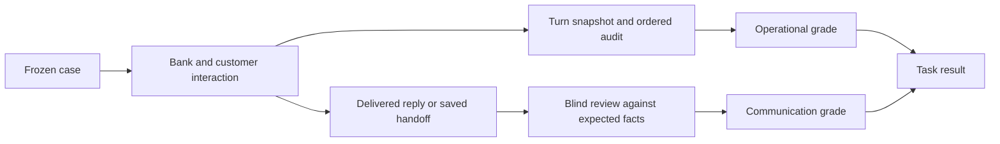

# Running and grading evaluations

Use Python 3.12, a signed-in Codex CLI and Docker for the default BenchFlow backend. From the project root, install the pinned dependencies in a virtual environment. The host runs the model and the trial container owns the bank tools, reviewer and SQLite ledger. Evidence, handoff and routing cases also use a private env0 Gmail service for merchant correspondence. On Apple Silicon the pinned mail image needs amd64 emulation.

```sh
uv venv --python 3.12 .venv
uv pip install --python .venv -r requirements-benchflow.txt -r requirements-tracking.txt
source .venv/bin/activate
python -m bank_demo.casebook generate audits/casebooks/refunds.json --seed 41 --family refund --behaviour cooperative --difficulty medium
python -m bank_demo.casebook run audits/casebooks/refunds.json --arm baseline --repeats 2
```

Set `--workers` for concurrency (BenchFlow defaults to eight), `--customer-mode llm` for a simulated customer, or `--backend local` for in-process debugging. Each case and repeat has its own workspace. The batch directory contains the casebook, manifest and report. Its trial directories contain audit logs and ledger snapshots. Generate new development worlds with a new seed. Reserve `--split holdout` for the final comparison. [Scenario catalogue](task-taxonomy.md)

For the authored scenarios run `python -m bank_demo.evaluate --suite baseline`, `--suite ledger` or `--suite claims`. The claims suite accepts `--customer-mode both`. Both runners exit with 2 for an execution error, 1 for a known task failure, 3 for outstanding review alone and 0 when all tasks pass.

## Reading scores

For generated cases with a frozen service date, the bank and simulated customer receive that date as their session's “today.” Audit timestamps still record actual execution time.

All generated bank families share a runaway limit of 128 tool calls per customer turn. A `call_limit` stop means the harness blocked a request. The turn audit records the configured ceiling and denied request. For scored conversations with complete audits, MLflow logs `bank_tool_requests`, `max_tool_requests_per_turn`, `tool_limit_stops` and `context_limit_stops`. The generated-run manifest also records the context budget and model timeout, and paired skill comparisons require matching limits. Terra allows ten minutes per model decision. The sandbox gives its host bridge another 40 seconds to return that decision and allows one hour for the whole trial.

Scorer version 7 records operational and communication verdicts across every required turn. A known failure on either dimension fails the task. An outstanding judgement receives `REVIEW`. `ERROR` identifies an incomplete execution or a broken evaluation. Card servicing checks can trace a receipt to its first verified tool result on an earlier turn. An explicitly requested new order check still needs current evidence. A recorded review restriction authorizes the identity referral independently of the app signature required for replacement. For a dispute and limit change on separate cards, the charge itself establishes its card link. For a conditional closure prevented by failed eligibility, a notice on the retained account can report the blocked closure. Both checks use the state and evidence available at that turn.

| Dimension | Evidence | Example |
| --- | --- | --- |
| Operational correctness | Bank state, specialist queue, receipts and ordered audit events | A referral needs the right case, destination and timing. A reviewer blocking a premature request still leaves a failed policy check. |
| Communication | The reply delivered to the customer or the handoff note stored for its recipient | The bank can correctly leave a draft open and still tell the customer it was closed. A call-limit message can prove that a requested answer never arrived. |
| Efficiency diagnostics | Unrelated lookups and repeated reads | An extra read shows up in the scorecard. Access restrictions and mandatory evidence checks have their own operational criteria. |

The queue entry serves as a structured artifact. Its charge references, destination, priority and attached evidence are checked directly. A handoff also needs meaningful content. The reviewer sees the actual note saved on the case thread. There is no need for the model to write a second account of its decision for the grader.

## Reviewing a frozen conversation

A free-form criterion records its expected facts, the delivered text and an optional wording signal. The signal helps measure how often a simple matcher would give the wrong answer. A human decision supplies the semantic grade. A reviewer should accept equivalent wording, read the reply in context and look for contradictions. For example, a correct date followed by an instruction to call on the wrong day fails the next-step criterion.



Set `batch` to the directory containing your generated report. For a batch with at least 12 cases, this example rebuilds the scorecard and selects 12 frozen worlds uniformly with a fixed seed. The packet includes every completed repeat of each selected world. Exporting without `--sample` includes every completed conversation.

```sh
batch=audits/evaluations/YOUR_BATCH_ID
python -m bank_demo.rescore "$batch"
python -m evaluation.review export "$batch/rescore-v7.json" "$batch/reviewer-copy.json" --sample 12 --seed 412
```

Each packet omits the arm, original verdict and matcher predictions. Fill in each criterion's `label` with `pass`, `fail` or `uncertain`. Leave unassessed criteria null. For an LLM customer, also mark `customer_fidelity` as `followed_brief`, `deviated` or `uncertain`. A deliberately misleading statement requested by the scenario follows the brief. An invented authorization that changes the task is a deviation. This annotation helps investigate attribution. A deviation alone does not establish that it caused the bank's error.

```sh
python -m evaluation.review apply "$batch/rescore-v7.json" "$batch/reviewer-copy.json" \
  --reviewer reviewer-a --output "$batch/reviewed-a.json"
```

The command validates the source fingerprint and the review evidence, then writes a separate report. It prints sample coverage and counts of false passes and false failures for the wording signals against the supplied labels. Assess independent development and held-out examples, including correct paraphrases and plausible contradictions. Two reviewers can label copies of the same packet independently and adjudicate disagreements before publishing a reference set. An uncertain label leaves the criterion open. A partial review can establish some failures, but a pass requires all required criteria to be settled.

## Comparing systems

Use the same frozen casebook, repeats, backend and model settings on both arms. For an agent comparison, use `--customer-mode scripted` on both arms. Those runs fix each customer message by turn. Repeat separately with `--customer-mode llm` on both arms to measure interaction with a customer who can respond to the bank within their scenario brief. Repeats in that condition include variability from both participants.

```sh
python -m evaluation.uplift "$baseline/report.json" "$candidate/report.json" --metric operational_correct
python -m evaluation.uplift "$baseline/reviewed-a.json" "$candidate/reviewed-a.json" --metric communication_correct --review-sample
python -m evaluation.uplift "$baseline/reviewed-a.json" "$candidate/reviewed-a.json" --metric task_pass --review-sample
```

Here `baseline` and `candidate` refer to separate named executions. Each case contributes equal weight, including when it has multiple repeats. The comparison reports a paired uncertainty interval, execution errors, status counts, simulator annotations and coverage. A world missing either arm's score for any repeat is excluded for that endpoint. The possible uplift range allows every missing binary score to take either value. The headline estimate and significance calculation for communication or task pass are withheld while required reviews are outstanding in the comparison population. Use the same review seed and size in both arms and select `--review-sample` to compare those worlds. Reviewing only communication failures or only operational passes can bias uplift.

New SQLite scenarios save a database snapshot at every scored turn. Replay restores each into a temporary fixture, reevaluates the state and checks the original public exchange against the audit. Pre-review observations come from the recorded review checks. For older SQLite runs, replay uses the saved final database and the recorded intermediate state checks. The report lists those evidence sources. In-memory tasks retain their recorded state observations.

## Development baseline

### Servicing development pilot

Use one independent world per observation and one attempt per arm. The primary endpoint is operational pass across every required customer turn. Compare the standard bank to the same bank with the existing task-completion skill supplied in context. Freeze the skill before collecting outcomes. In both arms use BenchFlow, Terra medium and the LLM customer. The simulator may phrase the same objective differently across arms. Preserve failed attempts, execution errors, guardrail stops, missing scores and model costs in the original reports.

For each new family, target 30 paired development worlds, uniformly covering its outcome-by-difficulty cells over complete cycles and rotating the customer behaviours. A partial cycle is sampled without replacement. The simulated customer writes the opening enquiry. In the seven payment, account and credit servicing families, its return turn delivers the frozen decision recorded in the app. The bank can read the signed permissions as a separate tool result. Card fulfilment has its own invitation and verification state machine. For example, to prepare the scheduled-payment casebook:

```sh
python -m bank_demo.casebook generate audits/casebooks/servicing-payments.json --seed 26112602 --family payment_instruction --worlds-per-family 30
python -m bank_demo.casebook run audits/casebooks/servicing-payments.json --arm servicing-baseline --customer-mode llm
python -m bank_demo.casebook run audits/casebooks/servicing-payments.json --arm servicing-skill --customer-mode llm --instructions bank_demo/skills/task-completion/SKILL.md
```

Use the same casebook for both arms. Pass their execution directories to `python -m evaluation.power BASELINE CANDIDATE --family payment_instruction`. It checks the independent worlds, counts fixes and regressions, and reports baseline headroom, uncertainty around disagreement, required pairs and estimated dollar cost. Missing scores remain visible. A per-difficulty significance claim needs its own sizing.

For a single-family confirmation, use fresh seeds and `--split holdout --worlds-per-family N --sampling iid` after freezing the candidate, grader and family mix. This draws each world's outcome, difficulty and customer behaviour independently from the uniform mix assumed by the exact McNemar power calculation. The balanced pilot spreads observations over cells to help diagnose weaknesses. Its small-sample disagreement estimate and price per pair are planning inputs. A fixed-quota holdout or a different traffic mix requires a corresponding power analysis. [Build plan and power assumptions](../plan.md#benchmark-informed-servicing-tasks)

The November 2026 pilot froze source and cases before each pair of executions. Card operations used seed 26112601. A first servicing batch exposed duplicate cheque identities and a disagreement between the simulated customer's words and trusted consent. Both arms were stopped after 11 completed attempts each. Those calibration traces are retained separately. Their known model usage was $1.23 across 291 of 301 requested calls, including unfinished conversations. All seven servicing families restarted on fresh worlds from seed 26112602.

Scorer v7 replays both arms from their original SQLite snapshots and ordered events. It accepts previously verified receipts, proof of a card link from its charge, and a scoped no-change notice on the retained account after a conditional opening fails. A fresh quote on a particular loan establishes which loan was checked. These changes affect grading only. The raw scorecards remain available to measure their effect. Subsequent runs apply these rules at execution.

### November 2026 servicing results

All **330 independent worlds** received one attempt per arm. The standard bank passed **291/330** operationally and the same bank with the task-completion skill passed **292/330**. Twelve worlds improved, eleven regressed and all 660 attempts produced a score and complete token pricing. Estimated bank and customer usage was **$29.19**. These development observations support sample planning. They do not establish that the skill improves service.

Each arm saw 30 worlds per row. Wins and losses count changes from baseline to skill. The holdout is sized for one preselected family, a 10-point gain, 80% power and a two-sided 5% significance level. The budget interval is a 95% paired bootstrap interval for expected cost at the planned sample size and frozen token prices. Trials used Codex subscription access. Dollars are rate-card equivalents.

| Family | Baseline passes | Skill passes | Wins / losses | Pilot cost | Fresh worlds | Holdout cost (95% interval) |
| --- | ---: | ---: | ---: | ---: | ---: | ---: |
| `payment_instruction` | 25 | 23 | 1 / 3 | $2.72 | 220 | $19.91 ($18.29–$21.33) |
| `cheque_service` | 18 | 18 | 2 / 2 | $2.46 | 220 | $18.03 ($16.71–$19.32) |
| `account_lifecycle` | 30 | 29 | 0 / 1 | $3.32 | Ceiling | — |
| `term_deposit` | 23 | 24 | 1 / 0 | $2.81 | 111 | $10.41 ($9.29–$11.46) |
| `loan_service` | 21 | 23 | 4 / 2 | $2.46 | 283 | $23.20 ($20.15–$26.15) |
| `atm_fee` | 30 | 30 | 0 / 0 | $2.83 | Ceiling | — |
| `dispute_credit_limit` | 30 | 29 | 0 / 1 | $3.70 | Ceiling | — |
| `card_delivery` | 30 | 30 | 0 / 0 | $1.49 | Ceiling | — |
| `card_address_change` | 29 | 28 | 1 / 2 | $2.27 | Ceiling | — |
| `card_reissue` | 26 | 28 | 2 / 0 | $2.80 | 154 | $14.38 ($12.36–$16.38) |
| `card_identity` | 29 | 30 | 1 / 0 | $2.33 | Ceiling | — |

**How to read the sizing.** Ceiling means fewer than three observed baseline failures in 30 worlds. A 10-point gain exceeds the observed headroom. The true rate is uncertain. Even 30/30 passes give a two-sided 95% Wilson headroom interval of roughly 0–11.4 points. In the five sized families, the disagreement fractions used for planning were 13.6% for term deposits, 18.3% for card reissue, 26.6% for payments and cheques, and 34.3% for loans. These are one-sided 95% Wilson upper bounds from the pilot. A different skill can change how often outcomes disagree. The estimator also emits sensitivity sizes and headroom intervals for every family.

**What failed.** The baseline passed all database and committed-write checks on 324/330 worlds, compared with 323/330 for the skill. The stricter operational endpoint also includes required observations, authority and structured delivery. All nine baseline loan failures involved evidence checks. For example, a bank that reported the correct pending instalment before inspecting the applicable policy failed the procedure. To study financial execution errors, the state-only baseline leaves much less headroom. Eight conversations failed a deterministic communication check and the other 652 still require communication review.

**Difficulty.** Baseline operational passes were 97/110 easy, 95/109 medium and 99/111 hard. With the skill they were 96/110, 93/109 and 103/111. Median tool requests per conversation rose from six to seven to eight in both arms. The current levels distinguish workload more clearly than failure probability for Terra. Three of four baseline reissue failures involved easy acknowledgement-loss cases. Group by the underlying decision as well as the level when investigating failures.

**Calibration and reproducibility.** The original scorers recorded 280/330 baseline passes and 281/330 skill passes. After the rubric corrections, eleven failures changed to operational passes in each arm. Identity and compound dispute/limit both dropped off the list of families with sufficient observed headroom. Original reports and v7 replays are kept side by side. The separate three-world loan workflow cost $0.45 and remains outside these figures. [Loan workflow and evidence](servicing-task-design.md#exploratory-check-on-a-new-loan-workflow)

The local card baseline and skill run IDs are `74aeaf0a101149cd8112b7c6b59a7b8b` and `137cc395eff44f3fb020a1057dfb636f`. The seven-family baseline and skill IDs are `5dd2495a11d54ecab5dadd92c30f631f` and `a0fdb245de404a95a8d52316b56c7d24`. Under `audits/evaluations/`, use each pair's `rescore-v7.json` files with `evaluation.power` to reproduce the table. Use `report.json` for the original verdicts. The private `audits/casebooks/servicing-261126/holdout/manifest.json` lists **988 fresh worlds** reserved across the five families. No holdout has been run. Running all five at their individual sizes would take 1,976 conversations and an estimated $85.93. Simultaneous confirmatory claims across multiple families require a prespecified multiple-comparison adjustment and new sizes.

### Matched refund and external banking pilots

The matched refund pilot freezes the customer messages, tools, policy, amount and purchases within each pair. Only the credit's purchase reference changes. A pair passes when both conversations complete their turns and pass the operational checks, including the saved draft and mutation journal. Communication quality has a separate verdict. Run the frozen book with a scripted customer.

```sh
python -m bank_demo.refund_pairs freeze audits/casebooks/refund-pairs-26112510.json --seed 26112510 --pairs 3
python -m bank_demo.casebook run audits/casebooks/refund-pairs-26112510.json --arm refund-pairs-terra --customer-mode scripted --repeats 2
# Set batch to the directory printed by the run above.
python -m bank_demo.refund_pairs score "$batch/report.json"
```

To freeze new worlds, use `python -m bank_demo.refund_pairs freeze FILE --seed SEED --pairs N`. For an external comparison, the τ-Banking pilot uses Sierra v1.0.1, its BM25 search, original customer simulator and database grader. The first two task IDs each run twice with Terra medium over the project's Codex subscription adapter. Both concern credit card selection. The official score applies to the whole bank–customer interaction. Compare results within this pilot when changing an agent.

From this project root, use a Python environment with the upstream knowledge dependencies installed. Pass a local Sierra Git checkout containing the pinned release and a new results directory.

```sh
/path/to/tau2/.venv/bin/python -m evaluation.tau_banking /path/to/tau2 audits/benchmarks/new-run
```

The pilot exports the pinned code and data from Git into a temporary directory. The manifest records the release commit, model settings, rate card and input bound. The results retain the conversations, tool calls, costs and reward components. [Sierra v1.0.1](https://github.com/sierra-research/tau2-bench/tree/v1.0.1)

Terra medium solved both sides of all three refund pairs on both attempts. Bank usage averaged $0.021 per conversation. In τ-Banking it scored zero on both card-selection tasks across both attempts, averaging $0.264 per conversation for the bank. All four conversations ended after a transfer without the expected card application. These small pilots measure specific workflows.

### Original 100-case development run

Replaying the 100 existing development conversations produced 92 operational passes and eight failures. Twelve conversations failed a communication requirement at delivery. The other 88 await review of what was communicated. The 12 separately repeated conversations yielded 11 operational passes and one operational failure. These are measurements of the existing bank agent under the revised criteria.
