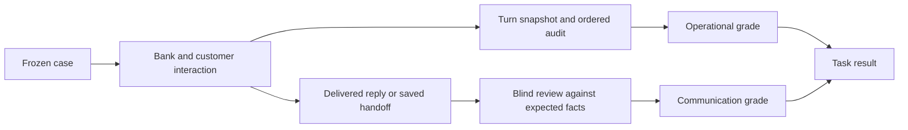

# Running and grading evaluations

Use Python 3.12, a signed-in Codex CLI and Docker for the default BenchFlow backend. From the project root, install the pinned dependencies in a virtual environment. The host runs the model and the trial container owns the bank tools, reviewer and SQLite ledger. Evidence, handoff and routing cases also use a private env0 Gmail service for merchant correspondence. On Apple Silicon the pinned mail image needs amd64 emulation.

```sh
uv venv --python 3.12 .venv
uv pip install --python .venv -r requirements-benchflow.txt -r requirements-tracking.txt
source .venv/bin/activate
python -m bank_demo.casebook generate audits/casebooks/refunds.json --seed 41 --family refund --behaviour cooperative --difficulty medium
python -m bank_demo.casebook run audits/casebooks/refunds.json --arm baseline --repeats 2
```

Set `--workers` for concurrency (BenchFlow defaults to eight), `--customer-mode llm` for a simulated customer, or `--backend local` for in-process debugging. Each case and repeat has its own workspace. The batch directory contains the casebook, manifest and report. Its trial directories contain audit logs and ledger snapshots. Generate new development worlds with a new seed. Reserve `--split holdout` for the final comparison. [Scenario catalogue](task-taxonomy.md)

For the authored scenarios run `python -m bank_demo.evaluate --suite baseline`, `--suite ledger` or `--suite claims`. The claims suite accepts `--customer-mode both`. Both runners exit with 2 for an execution error, 1 for a known task failure, 3 for outstanding review alone and 0 when all tasks pass.

## Reading scores

For generated cases with a frozen service date, the bank and simulated customer receive that date as their session's “today.” Audit timestamps still record actual execution time.

All generated bank families share a runaway limit of 128 tool calls per customer turn. A `call_limit` stop means the harness blocked a request. The turn audit records the configured ceiling and denied request. For scored conversations with complete audits, MLflow logs `bank_tool_requests`, `max_tool_requests_per_turn`, `tool_limit_stops` and `context_limit_stops`. The generated-run manifest also records the context budget and model timeout, and paired skill comparisons require matching limits. Terra allows ten minutes per model decision. The sandbox gives its host bridge another 40 seconds to return that decision and allows one hour for the whole trial.

Scorer version 5 records two verdicts for each conversation. Each verdict covers every required turn. A known failure on either dimension fails the task. A task with an outstanding judgement receives `REVIEW`. `ERROR` identifies an incomplete execution or a broken evaluation.

| Dimension | Evidence | Example |
| --- | --- | --- |
| Operational correctness | Bank state, specialist queue, receipts and ordered audit events | A referral needs the right case, destination and timing. A reviewer blocking a premature request still leaves a failed policy check. |
| Communication | The reply delivered to the customer or the handoff note stored for its recipient | The bank can correctly leave a draft open and still tell the customer it was closed. A call-limit message can prove that a requested answer never arrived. |
| Efficiency diagnostics | Unrelated lookups and repeated reads | An extra read shows up in the scorecard. Access restrictions and mandatory evidence checks have their own operational criteria. |

The queue entry serves as a structured artifact. Its charge references, destination, priority and attached evidence are checked directly. A handoff also needs meaningful content. The reviewer sees the actual note saved on the case thread. There is no need for the model to write a second account of its decision for the grader.

## Reviewing a frozen conversation

A free-form criterion records its expected facts, the delivered text and an optional wording signal. The signal helps measure how often a simple matcher would give the wrong answer. A human decision supplies the semantic grade. A reviewer should accept equivalent wording, read the reply in context and look for contradictions. For example, a correct date followed by an instruction to call on the wrong day fails the next-step criterion.



Set `batch` to the directory containing your generated report. For a batch with at least 12 cases, this example rebuilds the scorecard and selects 12 frozen worlds uniformly with a fixed seed. The packet includes every completed repeat of each selected world. Exporting without `--sample` includes every completed conversation.

```sh
batch=audits/evaluations/YOUR_BATCH_ID
python -m bank_demo.rescore "$batch"
python -m evaluation.review export "$batch/rescore-v5.json" "$batch/reviewer-copy.json" --sample 12 --seed 412
```

Each packet omits the arm, original verdict and matcher predictions. Fill in each criterion's `label` with `pass`, `fail` or `uncertain`. Leave unassessed criteria null. For an LLM customer, also mark `customer_fidelity` as `followed_brief`, `deviated` or `uncertain`. A deliberately misleading statement requested by the scenario follows the brief. An invented authorization that changes the task is a deviation. This annotation helps investigate attribution. A deviation alone does not establish that it caused the bank's error.

```sh
python -m evaluation.review apply "$batch/rescore-v5.json" "$batch/reviewer-copy.json" \
  --reviewer reviewer-a --output "$batch/reviewed-a.json"
```

The command validates the source fingerprint and the review evidence, then writes a separate report. It prints sample coverage and counts of false passes and false failures for the wording signals against the supplied labels. Assess independent development and held-out examples, including correct paraphrases and plausible contradictions. Two reviewers can label copies of the same packet independently and adjudicate disagreements before publishing a reference set. An uncertain label leaves the criterion open. A partial review can establish some failures, but a pass requires all required criteria to be settled.

## Comparing systems

Use the same frozen casebook, repeats, backend and model settings on both arms. For an agent comparison, use `--customer-mode scripted` on both arms. Those runs fix each customer message by turn. Repeat separately with `--customer-mode llm` on both arms to measure interaction with a customer who can respond to the bank within their scenario brief. Repeats in that condition include variability from both participants.

```sh
python -m evaluation.uplift "$baseline/report.json" "$candidate/report.json" --metric operational_correct
python -m evaluation.uplift "$baseline/reviewed-a.json" "$candidate/reviewed-a.json" --metric communication_correct --review-sample
python -m evaluation.uplift "$baseline/reviewed-a.json" "$candidate/reviewed-a.json" --metric task_pass --review-sample
```

Here `baseline` and `candidate` refer to separate named executions. Each case contributes equal weight, including when it has multiple repeats. The comparison reports a paired uncertainty interval, execution errors, status counts, simulator annotations and coverage. A world missing either arm's score for any repeat is excluded for that endpoint. The possible uplift range allows every missing binary score to take either value. The headline estimate and significance calculation for communication or task pass are withheld while required reviews are outstanding in the comparison population. Use the same review seed and size in both arms and select `--review-sample` to compare those worlds. Reviewing only communication failures or only operational passes can bias uplift.

New SQLite scenarios save a database snapshot at every scored turn. Replay restores each into a temporary fixture, reevaluates the state and checks the original public exchange against the audit. Pre-review observations come from the recorded review checks. For older SQLite runs, replay uses the saved final database and the recorded intermediate state checks. The report lists those evidence sources. In-memory tasks retain their recorded state observations.

## Development baseline

### Matched refund and external banking pilots

The matched refund pilot freezes the customer messages, tools, policy, amount and purchases within each pair. Only the credit's purchase reference changes. A pair passes when both conversations complete their turns and pass the operational checks, including the saved draft and mutation journal. Communication quality has a separate verdict. Run the frozen book with a scripted customer.

```sh
python -m bank_demo.refund_pairs freeze audits/casebooks/refund-pairs-26112510.json --seed 26112510 --pairs 3
python -m bank_demo.casebook run audits/casebooks/refund-pairs-26112510.json --arm refund-pairs-terra --customer-mode scripted --repeats 2
# Set batch to the directory printed by the run above.
python -m bank_demo.refund_pairs score "$batch/report.json"
```

To freeze new worlds, use `python -m bank_demo.refund_pairs freeze FILE --seed SEED --pairs N`. For an external comparison, the τ-Banking pilot uses Sierra v1.0.1, its BM25 search, original customer simulator and database grader. The first two task IDs each run twice with Terra medium over the project's Codex subscription adapter. Both concern credit card selection. The official score applies to the whole bank–customer interaction. Compare results within this pilot when changing an agent.

From this project root, use a Python environment with the upstream knowledge dependencies installed. Pass a local Sierra Git checkout containing the pinned release and a new results directory.

```sh
/path/to/tau2/.venv/bin/python -m evaluation.tau_banking /path/to/tau2 audits/benchmarks/new-run
```

The pilot exports the pinned code and data from Git into a temporary directory. The manifest records the release commit, model settings, rate card and input bound. The results retain the conversations, tool calls, costs and reward components. [Sierra v1.0.1](https://github.com/sierra-research/tau2-bench/tree/v1.0.1)

Terra medium solved both sides of all three refund pairs on both attempts. Bank usage averaged $0.021 per conversation. In τ-Banking it scored zero on both card-selection tasks across both attempts, averaging $0.264 per conversation for the bank. All four conversations ended after a transfer without the expected card application. These small pilots measure specific workflows.

### Original 100-case development run

Replaying the 100 existing development conversations produced 92 operational passes and eight failures. Twelve conversations failed a communication requirement at delivery. The other 88 await review of what was communicated. The 12 separately repeated conversations yielded 11 operational passes and one operational failure. These are measurements of the existing bank agent under the revised criteria.
