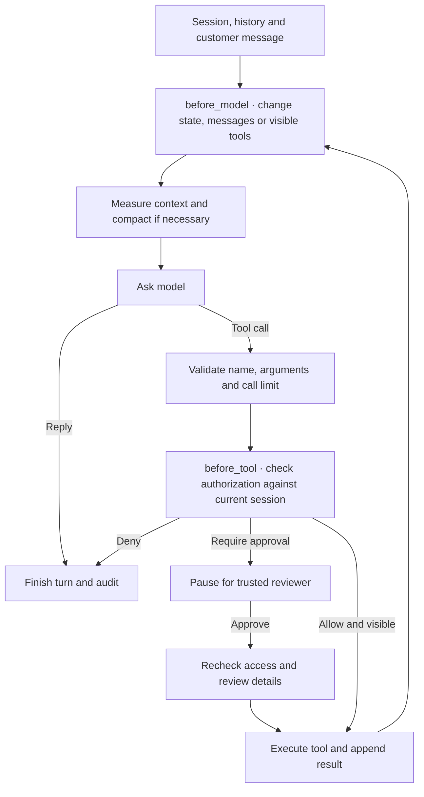
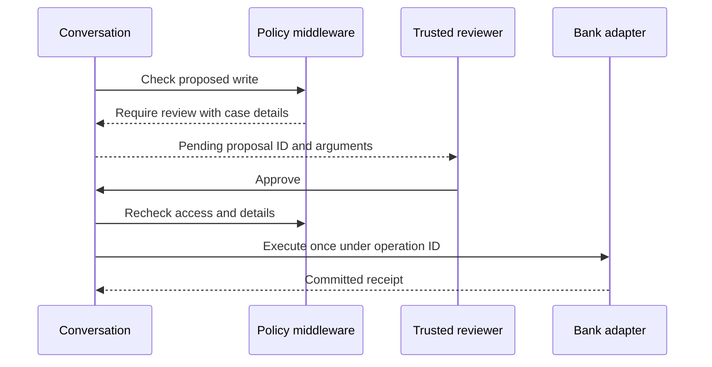

# Harness and middleware

Open one conversation for each authenticated login. Send follow-ups through the same handle. Each turn has its own JSONL audit, tool allowance and middleware state. The handle retains earlier messages, tool results and compaction history. `agent.run(message, session)` runs one isolated turn.

```python
chat = agent.conversation(session)
opening = chat.send("What is my available balance?")
followup = chat.send("How much has it changed since my first question?")
```

## Where middleware runs



Register layers with `Harness(..., middleware=[...])`. They run in registration order and receive copies. Return changes explicitly. Later layers see earlier updates.

| Hook | Return | Effect |
| --- | --- | --- |
| `before_model(session, state, messages, tools)` | `ModelChanges(state_updates=..., messages=..., hide_tools=...)` | Merge state keys for this turn. Replace messages or hide tools for this decision. |
| `before_tool(session, state, call)` | `ToolDecision(state_updates=..., denial=..., requires_approval=..., review_details=...)` | Allow, deny or pause the proposed dispatch. The first denial ends the chain. |

For example, the bank's session middleware replaces visible history with a sign-in instruction when access expires. It checks expiry again immediately before dispatch because the session may have expired during the model call. Follow the call ID through `tool.requested`, `middleware.decided` and `tool.denied` or `tool.started` in the turn audit. [Bank registration](../../bank_demo/__init__.py) · [Middleware interface](../../harness/middleware.py)

## Approval and recovery

A reviewed call returns `awaiting_approval` and a proposal. The host authenticates the reviewer, presents the frozen arguments and review details, then resumes with `chat.review(proposal.id, approve=decision, reviewer=reviewer_id)`. A later customer message supersedes the pending proposal. On approval the harness checks visibility, authorization and review details again. Each decision covers one proposal.



For restart recovery, configure `SQLiteCheckpoints`, a session owner key and a write adapter. Restore with `agent.reopen(conversation_id, current_session)`; use `chat.pending_proposal()` to rebuild the review screen. The demo binds a checkpoint to both customer and login. Its per-conversation lock works across processes on one host.

A write adapter implements `execute_once` and `reconcile`. It commits the mutation and receipt atomically under the operation ID. After an interruption a receipt confirms the commit, and authoritative absence allows retry under the same ID. An uncertain lookup leaves the operation pending as `operation_unconfirmed`. Run `python3 -m bank_demo.recovery --seed 41` for the interruption scenarios. [Checkpoint store](../../harness/checkpoints.py) · [Bank write adapter](../../bank_demo/ledger.py)
